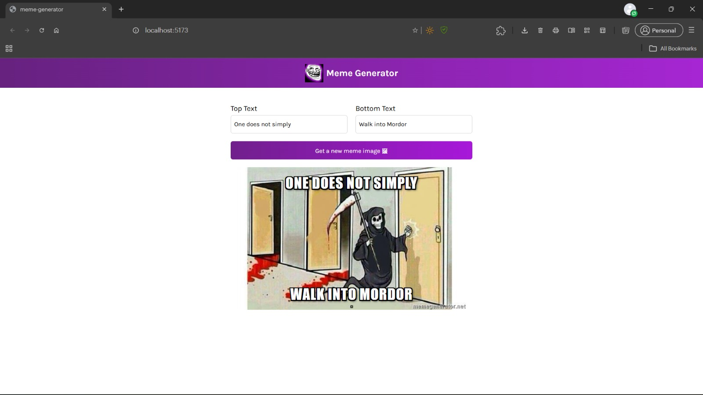

# 😂 Meme Generator

<p align="center">
  A simple, interactive, and fun Meme Generator built with React and Vite.
  <br />
  Create hilarious memes by choosing random templates and adding your own custom text!
</p>

<p align="center">
  <a href="https://meme-generator-app-psi.vercel.app/">
    <strong>🚀 Live Demo</strong>
  </a>
  &nbsp; · &nbsp;
  <a href="https://github.com/sairam-saridi/meme-generator-app">
    <strong>📂 GitHub Repository</strong>
  </a>
</p>

<p align="center">
  
  
  
  
</p>

---

## 📸 Project Preview



---

## ✨ About The Project

**Meme Generator** is a React-based web application that allows users to create personalized memes quickly and easily.

The application fetches popular meme templates from the [Imgflip API](https://api.imgflip.com/get_memes), selects a random template, and allows users to customize it with their own top and bottom text.

The goal of this project was to practice React fundamentals, component-based development, state management, API integration, and building interactive user interfaces.

## 🚀 Features

- 🎲 **Random Meme Generation** – Get a random meme template with a single click.
- ✍️ **Custom Text Input** – Add personalized text to the top and bottom of your meme.
- ⚡ **Live Preview** – View your customized meme as you type.
- 🌐 **API Integration** – Fetch meme templates dynamically using the Imgflip API.
- 🎨 **Clean User Interface** – Simple, attractive, and easy-to-use design.
- 📱 **Responsive Image Display** – Meme images automatically fit the available content area.

## 🛠️ Tech Stack

| Technology | Purpose |
|---|---|
| React 19 | Building reusable UI components |
| Vite | Development server and build tool |
| JavaScript (ES6+) | Application logic and interactivity |
| HTML5 | Application structure |
| CSS3 | Styling and layout |
| Imgflip API | Fetching meme templates |
| Vercel | Deployment and hosting |
| Git & GitHub | Version control and source code management |

## ⚙️ Getting Started

Follow these instructions to run the project locally.

### Prerequisites

Make sure you have the following installed:

- [Node.js](https://nodejs.org/)
- npm (included with Node.js)
- [Git](https://git-scm.com/)

### 1. Clone the repository

```bash
git clone https://github.com/sairam-saridi/meme-generator-app.git
```

### 2. Navigate to the project directory

```bash
cd meme-generator-app
```

### 3. Install dependencies

```bash
npm install
```

### 4. Start the development server

```bash
npm run dev
```

Open the local URL displayed in your terminal, usually:

```text
http://localhost:5173/
```

That's it! Your Meme Generator application is running locally.

## 📂 Project Structure

```text
meme-generator-app/
│
├── docs/
│   └── screenshots/
│       └── meme-generator-prj.jpeg
│
├── src/
│   ├── components/
│   │   ├── Header.jsx
│   │   └── Main.jsx
│   │
│   ├── images/
│   │   └── troll-face.jpeg
│   │
│   ├── App.jsx
│   ├── index.css
│   └── index.jsx
│
├── .gitignore
├── eslint.config.js
├── index.html
├── LICENSE
├── package.json
├── package-lock.json
├── README.md
└── vite.config.js
```

## 🔌 API Integration

This project uses the **Imgflip Public API** to retrieve meme templates.

**API Endpoint:**

```text
https://api.imgflip.com/get_memes
```

The application uses this endpoint to:

1. Retrieve available meme templates.
2. Store the returned meme data in React state.
3. Select a random meme template when the user clicks the generation button.
4. Update the displayed meme with the selected image.

**Note:** An active internet connection is required to retrieve meme templates from the API.

## 📜 Available Scripts

| Command | Description |
|---|---|
| `npm run dev` | Starts the local development server |
| `npm run build` | Creates an optimized production build |
| `npm run preview` | Previews the production build locally |
| `npm run lint` | Runs ESLint to check code quality |

## 🌍 Deployment

This application is deployed using **Vercel**.

🔗 **Live Application:**  
https://meme-generator-app-psi.vercel.app/

### Deploy Your Own

1. Fork or clone this repository.
2. Import the repository into [Vercel](https://vercel.com/).
3. Select **Vite** as the framework preset.
4. Set the build command to `npm run build`.
5. Set the output directory to `dist`.
6. Click **Deploy**.

## 🎯 What I Learned

Through this project, I gained practical experience with:

- Building React applications using reusable components.
- Managing application state with React Hooks (`useState`).
- Fetching external data using the Fetch API.
- Handling user input and events.
- Working with dynamic images and conditional content.
- Styling applications using CSS.
- Building and deploying applications using Vite and Vercel.
- Managing source code using Git and GitHub.

## 🔮 Future Improvements

Some features that could be added in future versions:

- Download generated memes as image files.
- Allow users to select specific meme templates.
- Add multiple customizable text fields.
- Customize text color, font size, and positioning.
- Allow users to upload their own images.
- Save favorite memes.

## 🤝 Contributing

Contributions, suggestions, and feedback are welcome!

1. Fork this repository.
2. Create a new branch:

   ```bash
   git checkout -b feature/your-feature
   ```

3. Make your changes and commit them:

   ```bash
   git commit -m "Add your feature"
   ```

4. Push your branch:

   ```bash
   git push origin feature/your-feature
   ```

5. Open a Pull Request.

## 📄 License

This project is licensed under the MIT License. See the [LICENSE](LICENSE) file for details.

## 👨‍💻 Author

**Sairam Saridi**

- GitHub: [@sairam-saridi](https://github.com/sairam-saridi)
- Project Repository: [Meme Generator App](https://github.com/sairam-saridi/meme-generator-app)
- Live Demo: [Meme Generator](https://meme-generator-app-psi.vercel.app/)

---

<p align="center">
  ⭐ If you like this project, consider giving it a star on GitHub!
  <br /><br />
  <strong>Built with ❤️ using React and Vite.</strong>
</p>
